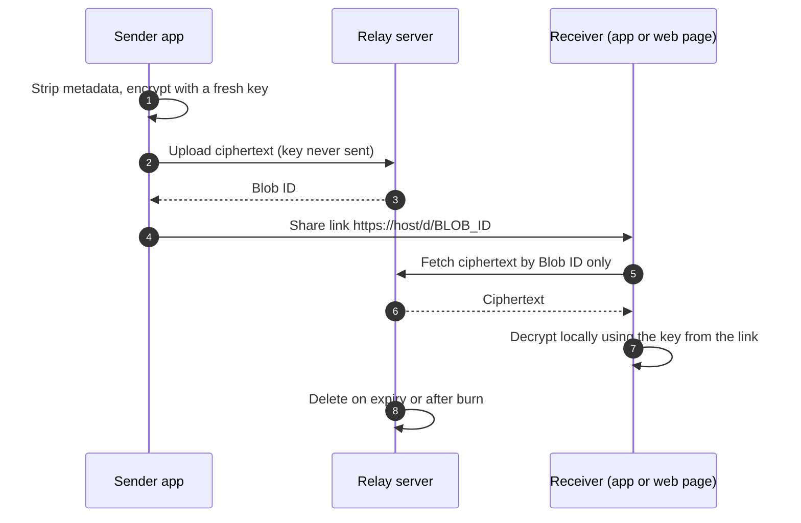
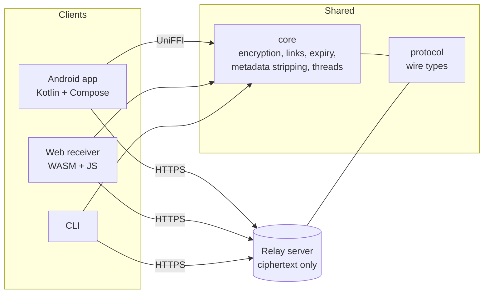

<div align="center">

# 🔥 Ember

**Send it once. Only they can open it.**

A private file-sharing app for Android and desktop.
No account. No phone number. Encrypted on your device before anything leaves it.


[How it works](#-how-it-works) ·
[Features](#-features) ·
[Honest limits](#-honest-limits) ·
[Quick start](#-quick-start) ·
[Architecture](#-architecture) ·
[Roadmap](#-roadmap) ·
[Docs](#-documentation)

</div>

> [!WARNING]
> **Early development.** The code is under active build and has not had an independent security audit. Do not use it for anything that matters yet.

---

## ✨ How it works

1. **Pick** a file or write a message.
2. **Ember encrypts it on your device** and uploads only ciphertext to a relay server.
3. **You get a link** (or QR code). The decryption key lives in the part of the link after `#`, which is never sent to the server.
4. **Share the link** however you like. Add a passphrase for a second lock.
5. **The drop expires** after at most 12 hours, or right after it is opened if you chose *burn after view*.



---

## 🧰 Features

| | Feature | Status |
|---|---|---|
| 🔐 | End-to-end encrypted files and text, chunked and authenticated | ✅ Built |
| 🧾 | No accounts, no phone numbers, no sign-up | ✅ Built |
| 🔑 | Optional passphrase on top of the link key (Argon2id) | ✅ Built |
| ⏳ | Server-enforced expiry of 12 hours at most | ✅ Built |
| 🔥 | Burn after first completed view | ✅ Built |
| 🧹 | Location and author metadata stripped from photos and documents before upload | ✅ Built |
| 📷 | QR code create and scan, share-sheet and paste-link intake | ✅ Built |
| 🌐 | Receive-only web page, no install needed | ✅ Built |
| 💻 | Command-line client for testing and scripting | ✅ Built |
| 🛡️ | Proof-of-work and rate limits to slow down abuse | ✅ Built |
| 💬 | Short 1:1 thread per drop with temporary handles (for example `amber-fox-4821`) | 🚧 In progress |
| 🚩 | Report and block, Hindi and English, accessibility checks | 🚧 In progress |
| 📡 | Offline transfer when two people are close together | 🗓️ Planned |
| 🖥️ | Desktop app | 🗓️ Planned |

---

## ⚖️ Honest limits

Ember is a privacy tool, so it says plainly what it cannot do.

<details open>
<summary><b>What Ember cannot promise</b></summary>

- **A recipient can keep a copy.** Screenshots, a camera, or a saved file defeat expiry. Expiry cannot prevent that.
- **A modified app can ignore expiry rules** on the device that runs it.
- **The server cannot read content, but it can see metadata** such as timing and network addresses. What is stored is described in [`docs/privacy-and-logging.md`](docs/privacy-and-logging.md).
- **Whoever holds the link can open the drop**, unless a passphrase is also set.
- **Threads are new.** The thread handshake is built on the audited `snow` (Noise) library, but it has not yet had an independent review. No claims are made about thread forward secrecy until it has.
- **Not an app for classified or government use.**

</details>

---

## 🚀 Quick start

You need a recent stable **Rust** toolchain. Clone the repo, then pick a path below.

<details>
<summary><b>🧪 Run the checks</b></summary>

```bash
# Rust: format, lint, tests, dependency and licence checks
scripts/check.sh          # Linux / macOS / Git Bash
scripts/check.ps1         # Windows PowerShell

# Quick version
cargo test --workspace
```

</details>

<details>
<summary><b>🖧 Start a relay server</b></summary>

```bash
cargo run -p ember-server -- --help

# Local test server on port 8080
cargo run -p ember-server -- --host 127.0.0.1 --port 8080
```

`-H` / `--host` sets the bind address; `-h` / `--help` prints help. Defaults: host `127.0.0.1`, port `8080`, blobs stored under `data/blobs`.

</details>

<details>
<summary><b>⌨️ Send and receive with the CLI</b></summary>

```bash
# Send a file (expires in 12 h by default; add --burn to delete after first view)
cargo run -p ember-cli -- send ./report.pdf --relay http://127.0.0.1:8080

# With a passphrase and burn after view
cargo run -p ember-cli -- send ./report.pdf --passphrase "correct horse" --burn

# Receive from a share link
cargo run -p ember-cli -- receive "https://host/d/BLOB_ID#PAYLOAD" --output ./received.pdf

# Start or join a short 1:1 thread for a drop
cargo run -p ember-cli -- thread "https://host/d/BLOB_ID#PAYLOAD"
```

Run any command with `--help` for all options.

</details>

<details>
<summary><b>🌐 Build the web receiver</b></summary>

```bash
cd web-receiver
npm install
npm test        # runs the shared test vectors
npm run build   # bundles the static receive-only page
```

</details>

<details>
<summary><b>📱 Build the Android app</b></summary>

Requirements: JDK (Temurin 25 used so far), Android SDK 37, Build Tools 37.0.0, NDK `28.2.13676358`, `cargo-ndk`, and the Rust targets `aarch64-linux-android`, `armv7-linux-androideabi`, `x86_64-linux-android`.

```bash
# Full Android gate: Rust bindings, unit tests, emulator tests,
# lint, three ABIs, release minification, dependency checks
scripts/check-android.sh
```

On Windows, run it from Git Bash with the SDK and NDK paths set. Release APKs are about 7.5 to 8 MiB per ABI.

</details>

---

## 🏗️ Architecture

One Rust core holds all the security-critical code. Every client is a thin shell around it.



<details>
<summary><b>🔬 Cryptography at a glance</b></summary>

No custom cryptography. Drops use well-known libsodium-compatible primitives.

| Purpose | Primitive |
|---|---|
| File and text content | `secretstream` XChaCha20-Poly1305, 1 MiB chunks |
| Passphrase to key | Argon2id |
| Key wrapping | XChaCha20-Poly1305 (IETF) |
| Sub-key derivation | BLAKE2b KDF |
| Thread handshake | Noise `NNpsk2_25519_ChaChaPoly_BLAKE2s` via the `snow` crate |

The server never receives the content key, the link fragment, or the passphrase. Full details are in [`docs/protocol-spec.md`](docs/protocol-spec.md), and every implementation must pass the shared [test vectors](testvectors/).

</details>

<details>
<summary><b>📁 Repository layout</b></summary>

| Path | Purpose |
|---|---|
| `core/` | Rust: encryption, link format, expiry rules, metadata stripping, threads |
| `protocol/` | Rust: wire types shared by core and server |
| `server/` | Rust relay server (stores ciphertext only) |
| `android-bindings/` | UniFFI wrapper that exposes the core to Kotlin |
| `android/` | Android app |
| `web-receiver/` | Minimal receive-only web page |
| `tools/cli/` | Command-line client |
| `tools/admin-cli/` | Admin tool for deletion by ID and takedown logging |
| `desktop/` | Desktop app (later) |
| `testvectors/` | Shared vectors every implementation must pass |
| `docs/` | Blueprint, build guide, protocol spec, threat model, ADRs |

</details>

---

## 🗺️ Roadmap

- [x] **M0–M4** Foundations, core crypto, relay server, abuse controls
- [x] **M5** Web receiver
- [x] **M6–M8** CLI, admin tools, security review
- [x] **M9** Android project and Rust bindings
- [x] **M10** Android send and receive
- [ ] **M11** Threads UI, report and block, Hindi and English, accessibility
- [ ] **M12** Reproducible builds and store packaging
- [ ] **M13** Beta testing, independent audit, legal opinion
- [ ] Later: nearby (offline) mode, desktop app

Progress is tracked milestone by milestone in [`docs/EMBER_BUILD_GUIDE.md`](docs/EMBER_BUILD_GUIDE.md).

---

## 📚 Documentation

| Read this | For |
|---|---|
| [`docs/EMBER_PROJECT_BLUEPRINT.md`](docs/EMBER_PROJECT_BLUEPRINT.md) | Product plan, decisions, audience |
| [`docs/EMBER_BUILD_GUIDE.md`](docs/EMBER_BUILD_GUIDE.md) | Milestones, rules, handoff log |
| [`docs/protocol-spec.md`](docs/protocol-spec.md) | Wire format, link format, server API |
| [`docs/threat-model.md`](docs/threat-model.md) | What Ember defends against and what it does not |
| [`docs/privacy-and-logging.md`](docs/privacy-and-logging.md) | Exactly what the server keeps |
| [`docs/adr/`](docs/adr/) | Architecture decision records |
| [`docs/legal/`](docs/legal/) | Draft terms, privacy policy, takedown process |

---

## 🤝 Contributing

Contributors and coding agents: read [`docs/EMBER_BUILD_GUIDE.md`](docs/EMBER_BUILD_GUIDE.md) first and follow its rules. Run the gate for your area before every commit, and add a handoff-log entry when you finish a milestone.

## 🔒 Reporting a vulnerability

See [`SECURITY.md`](SECURITY.md). Until a security contact is published, open a private security advisory on this repository. Please do not include real user data.

## 📄 Licence

[AGPL-3.0-only](LICENSE)
